# Telas do Olho no Rio

Documento das telas e dos fluxos de navegação (entregáveis da Pessoa B).

As capturas foram geradas com o repositório de exemplo (`EstacaoRepositoryMock`), num celular de 412 × 892 dp. Os valores são fictícios; códigos, nomes e coordenadas das estações são reais. Antes da entrega, refazer as capturas no emulador com a API real.

## Fluxo de navegação

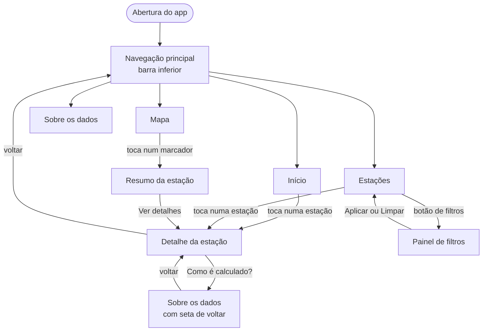

- A barra inferior troca de aba sem perder o estado de cada uma (busca, filtros e posição do mapa).
- O detalhe e a tela "Sobre" aberta pelo detalhe entram por cima, com seta de voltar.
- A estrela de favorito aparece na lista, na tela inicial e no detalhe; as três ficam sincronizadas.

## Abertura

Fundo azul-rio com a gota do ícone. No Android 12 ou superior usa a tela de abertura do sistema; nas versões anteriores, `launch_background.xml`. Some quando o Flutter desenha o primeiro quadro.

## Início (HM-01)

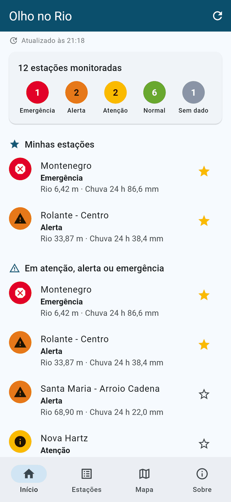

- **Atualizado às HH:MM** (HM-09). Sem conexão, vira uma faixa vermelha avisando de que horário são os dados, com botão "Tentar".
- **Resumo da rede**: quantas estações há em cada nível.
- **Minhas estações**: as favoritas, das mais graves para as menos graves. Sem favoritas, explica como adicionar.
- **Em atenção, alerta ou emergência**: todas as estações acima do normal.
- Rodapé com o aviso de que os alertas são indicativos e o telefone da Defesa Civil (199).
- Puxar para baixo ou tocar em ↻ atualiza. A lista também se atualiza sozinha a cada 5 minutos.

## Estações (HM-02, HM-05)

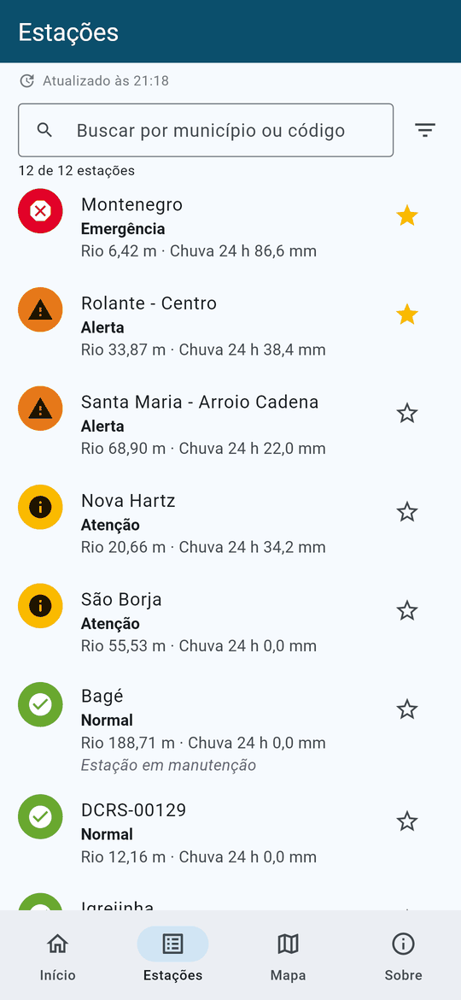 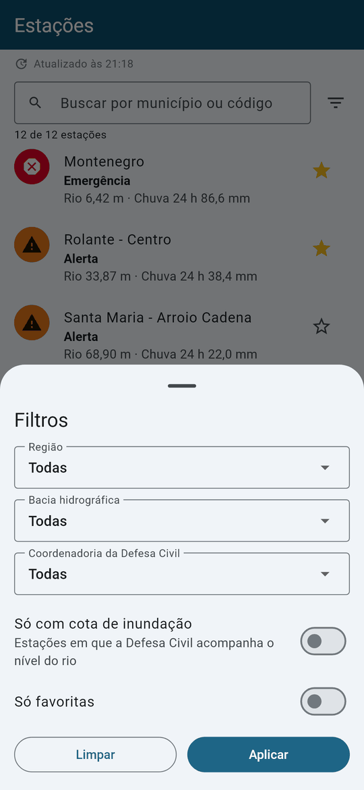

- Lista de todas as estações, da mais grave para a menos grave.
- Cada linha mostra o nível em **cor, ícone e texto**, para não depender só da cor; o nível do rio; a chuva em 24 h; e, se for o caso, "Dado atrasado", "Estação sem leitura recente" ou "Estação em manutenção".
- **Busca** por município ou código, sem diferenciar acentos ("sao borja" encontra "São Borja").
- **Filtros**: região, bacia hidrográfica, coordenadoria da Defesa Civil, "só com cota de inundação" e "só favoritas". O filtro por tipo de estação só aparece quando a rede tiver mais de um tipo (hoje todas são hidrometeorológicas). O ícone de filtro mostra quantos filtros estão ligados.
- O filtro por **período** do HM-05 fica no seletor de período dos gráficos, na tela de detalhe.

## Mapa (HM-02, HM-06)

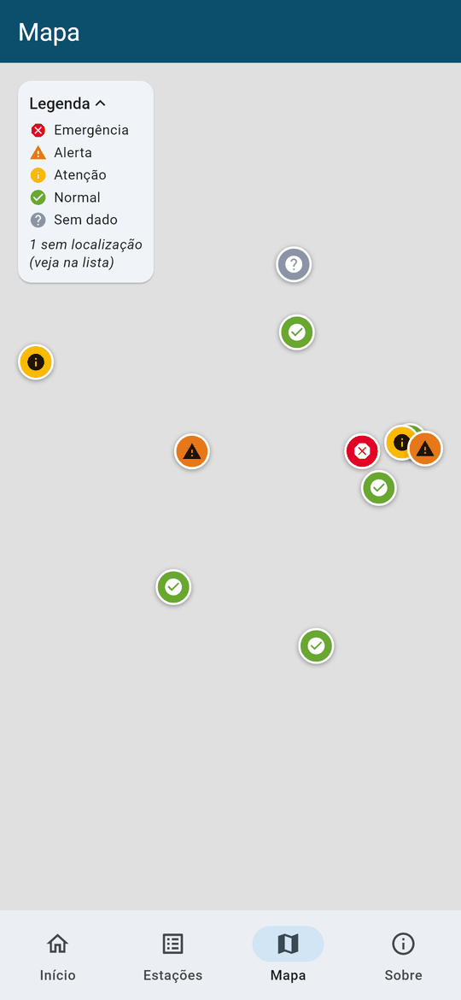

- Mapa do OpenStreetMap (na captura aparece cinza porque o teste roda sem internet) com um marcador por estação, na cor e com o ícone do nível.
- As estações mais graves ficam por cima das outras.
- **Legenda** recolhível, que também informa quantas estações estão sem coordenadas e por isso só aparecem na lista.
- Tocar num marcador abre um resumo (nível, rio, chuva, situação do dado) com o botão "Ver detalhes".

## Detalhe da estação (HM-03, HM-04, HM-06, HM-08, HM-09)

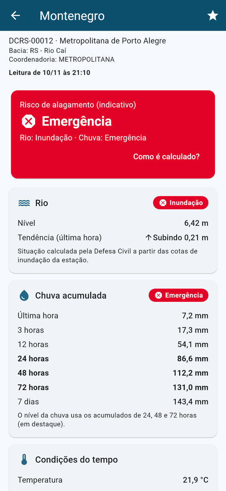 

- **Cabeçalho**: código, região, bacia, coordenadoria e horário da leitura. Mostra aviso de dado atrasado, ausente ou estação em manutenção.
- **Risco de alagamento (indicativo)** (HM-08): o mais grave entre rio e chuva, com a origem de cada um e o link "Como é calculado?".
- **Rio**: nível, tendência na última hora e a situação calculada pela Defesa Civil (Normal, Atenção, Alerta, Inundação). Explica quando a estação não tem cota cadastrada ou está sem leitura.
- **Chuva acumulada**: 1 h, 3 h, 12 h, 24 h, 48 h, 72 h e 7 dias, com o nível pela chuva. A chuva de 72 h é calculada pelo repositório a partir do histórico.
- **Condições do tempo**: só as variáveis que a estação mediu ("efetivamente disponíveis na fonte").

### Gráficos (HM-04, HM-06)

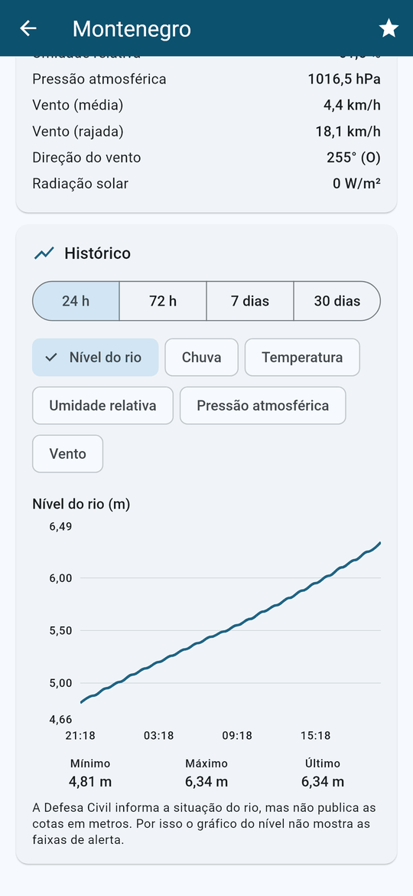 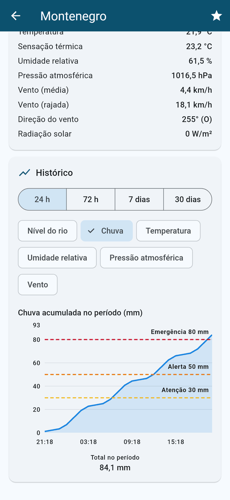 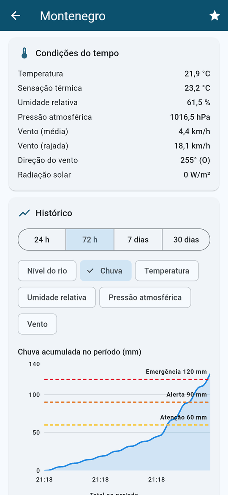

- **Período**: 24 h, 72 h, 7 dias ou 30 dias.
- **Variável**: nível do rio, chuva, temperatura, umidade, pressão e vento.
- Eixos com unidade e horário; tocar no gráfico mostra data, hora e valor do ponto.
- Abaixo de cada gráfico: mínimo, máximo e último valor (na chuva, o total do período).
- **Chuva**: mostra o acumulado do período, com as linhas de Atenção, Alerta e Emergência da tabela: 30, 50 e 80 mm em 24 h; 60, 90 e 120 mm em 72 h. As linhas muito acima dos dados ficam ocultas para não achatar o gráfico.
- **Nível do rio**: sem faixas, porque a Defesa Civil não publica as cotas em metros. O próprio gráfico explica isso.

## Sobre os dados (HM-10)

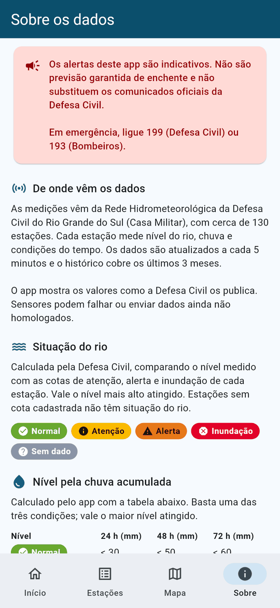 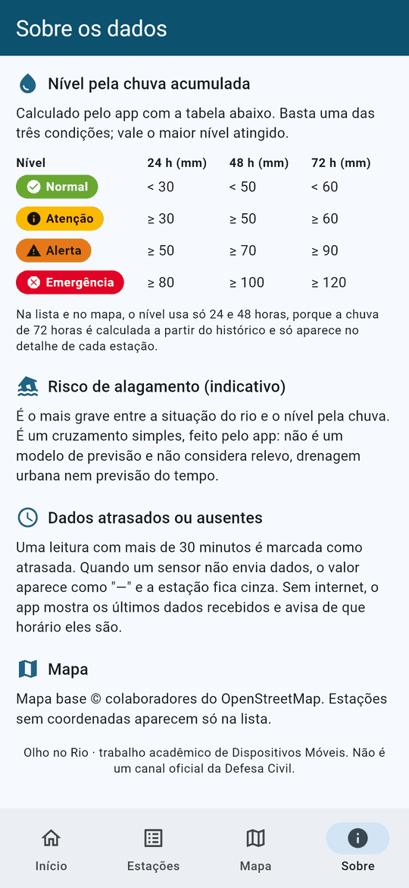

- Aviso em destaque: os alertas são indicativos, não são previsão garantida de enchente e não substituem a Defesa Civil. Telefones 199 e 193.
- Fonte dos dados, frequência de atualização e alcance do histórico.
- Situação do rio: como a Defesa Civil calcula e o significado das cores.
- Tabela de limiares da chuva, gerada do mesmo código que faz o cálculo (`limiaresChuva`), então não fica desatualizada.
- Como o risco de alagamento é calculado e o que ele não considera.
- O que significa dado atrasado ou ausente.

Os textos desta tela precisam ser validados pelo responsável técnico (HM-10).

## Estados tratados em todas as telas (HM-09)

| Situação | O que aparece |
|---|---|
| Primeira carga | Indicador de carregamento |
| Falha na primeira carga | Ícone, mensagem do tipo de falha e botão "Tentar de novo" |
| Falha numa atualização posterior | Faixa vermelha "… Mostrando dados das HH:MM" com botão "Tentar"; os dados anteriores continuam na tela |
| Dados vindos do cache | A mesma faixa |
| Leitura com mais de 30 min | "Dado atrasado: última leitura há X" |
| Estação sem leitura | "Estação sem leitura recente", cor cinza, valores "—" |
| Estação em manutenção | "Estação em manutenção" |
| Busca sem resultado | "Nenhuma estação encontrada." |
| Histórico sem dados ou com falha | Mensagem no lugar do gráfico, com "Tentar de novo" na falha |

## Acessibilidade e tamanhos de tela

- Nível nunca só por cor: sempre cor, ícone e texto. Marcadores do mapa e contadores têm descrição para leitor de tela.
- Textos em linhas com ícone quebram linha em vez de estourar a largura, então funcionam com fonte grande.
- Tema claro e escuro, seguindo a configuração do aparelho.
- **Pendente**: revisão de usabilidade em telas de tamanhos diferentes no emulador (celular pequeno, grande e tablet).

## Testes de navegação

Em [test/telas/navegacao_test.dart](../test/telas/navegacao_test.dart), todos com o mock:

- as quatro abas abrem suas telas;
- início mostra resumo, favoritas e estações em alerta; sem favoritas, mostra a orientação;
- busca sem acento encontra a estação, o toque abre o detalhe e o voltar retorna à lista com a busca preservada;
- o filtro "só com cota de inundação" reduz a lista;
- favoritar no detalhe faz a estação aparecer na tela inicial;
- o detalhe troca período e variável do gráfico;
- "Como é calculado?" abre a tela explicativa com seta de voltar;
- sem conexão na abertura, aparece o erro com "Tentar de novo".

Rodar com `flutter test`.
