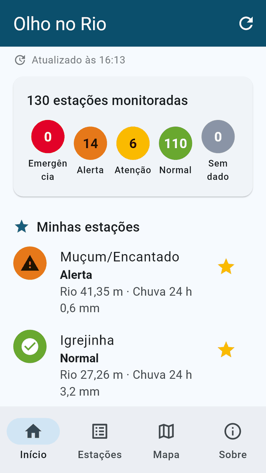
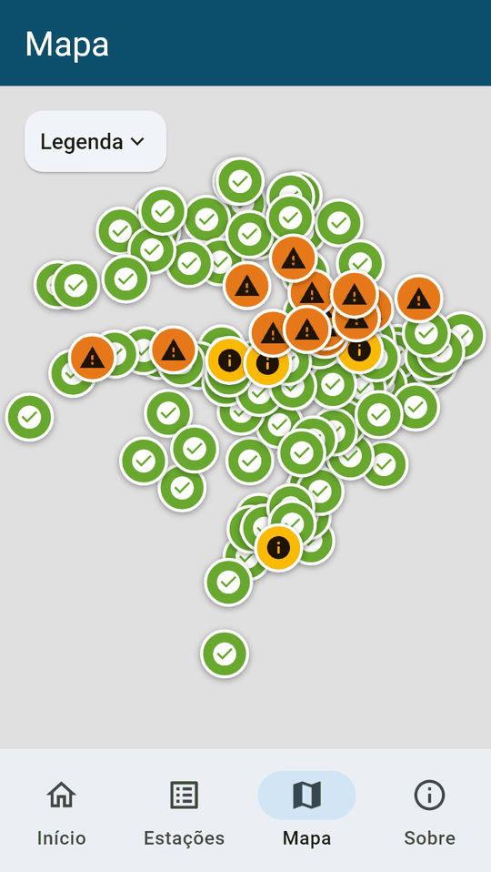
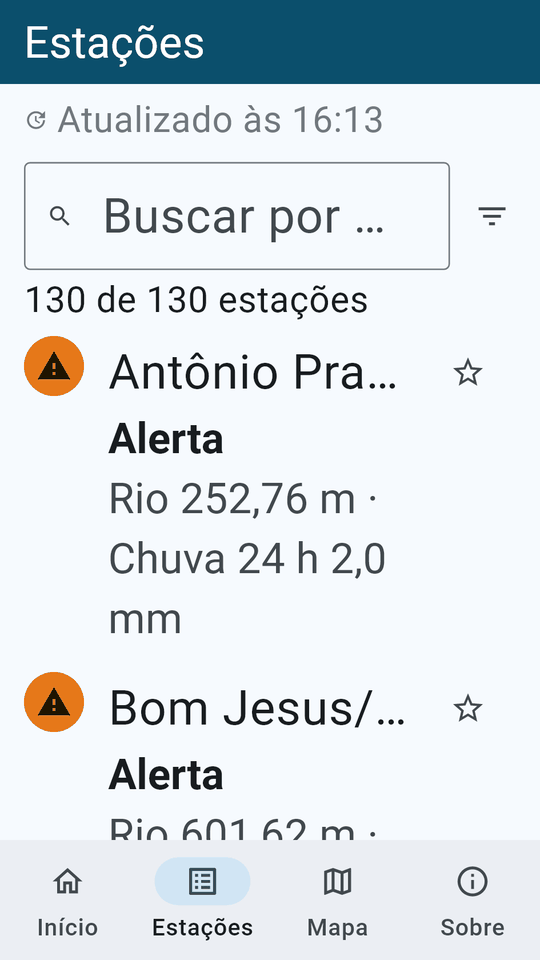
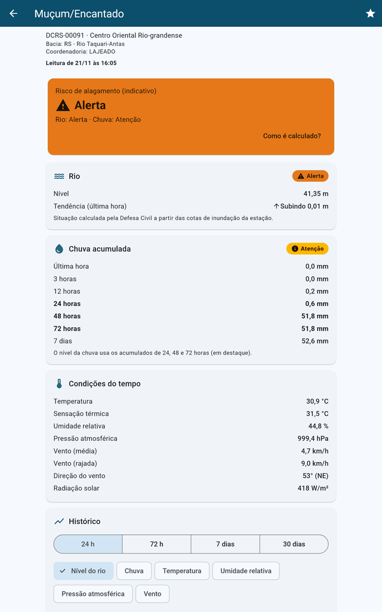
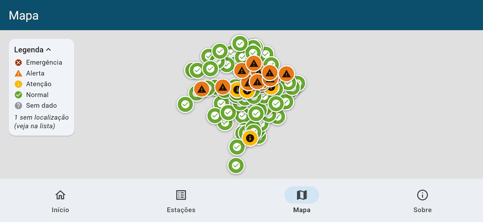

# Revisão de usabilidade em telas de tamanhos diferentes

Entregável da Pessoa B. Revisão feita em 21/11/2026, já com a API real como padrão.

## Como foi feita

Duas frentes:

1. **Teste automático** ([test/telas/tamanhos_tela_test.dart](../test/telas/tamanhos_tela_test.dart)). Percorre todas as telas em cada configuração da tabela abaixo: início, lista, painel de filtros, mapa com o resumo de uma estação, "Sobre" e o detalhe, trocando todos os períodos e variáveis do gráfico. Qualquer texto ou bloco que não caiba na tela gera erro e reprova o teste. O teste carrega a fonte Roboto que vem com o Flutter, para medir os textos como no celular. Roda com `flutter test`.
2. **Inspeção visual** das telas renderizadas com uma resposta real da API (130 estações, 21/11/2026 às 16:05) e o histórico real de duas estações.

| Configuração | Tamanho (dp) | Resultado final |
|---|---|---|
| Celular pequeno | 320 × 568 | ✅ |
| Celular comum | 360 × 640 | ✅ |
| Celular grande | 412 × 915 | ✅ |
| Celular deitado | 915 × 412 | ✅ |
| Tablet 8" | 800 × 1280 | ✅ |
| Tablet 10" deitado | 1280 × 800 | ✅ |
| Celular comum, fonte do sistema em 130% | 360 × 640 | ✅ |
| Celular comum, fonte do sistema em 200% | 360 × 640 | ✅ |

## Problemas encontrados e correções

| # | Onde | Problema | Configurações | Correção |
|---|---|---|---|---|
| 1 | Selo de nível (detalhe e "Sobre") | O rótulo ("Emergência", "Inundação") estourava a largura ao lado do título do cartão e na tabela de limiares | 320 e 360 dp; fonte 130% e 200% | O rótulo encurta com "…" quando não cabe; a coluna da tabela se ajusta ao selo |
| 2 | Cartão "Risco de alagamento" | O nome do nível em letra grande estourava a linha | Fonte 200% | O texto quebra linha |
| 3 | Resumo da estação no mapa | O painel ficava mais baixo que o conteúdo e cortava o botão "Ver detalhes" | Celular deitado | O painel rola |
| 4 | Legenda do mapa | Aberta, cobria marcadores, inclusive estações em alerta | Telas com menos de 400 dp de largura | Começa recolhida nessas telas e abre com um toque |
| 5 | Enquadramento do mapa | Com margem fixa, o estado ficava minúsculo no centro | Celular deitado | Margem proporcional ao tamanho da tela |
| 6 | Telas de leitura no tablet | Rótulo e valor ficavam a 700 dp de distância e as linhas de texto longas demais | Tablets e celular deitado | Conteúdo centralizado com largura máxima de 640 dp (o mapa continua em tela cheia) |
| 7 | Gráfico, eixo vertical | Rótulos do mínimo e do máximo se sobrepunham aos da grade ("42,06" sobre "42,00") | Todas, com dados reais | Só os rótulos das linhas da grade |
| 8 | Gráfico, eixo do tempo | Em 72 h aparecia "17:00, 17:00, 17:00", um rótulo por dia | Todas | Com um rótulo por dia ou mais, mostra a data ("19/11") |

Os itens 7 e 8 não apareciam com os dados de exemplo; só surgiram com séries reais.

## Como ficou

  

Celular pequeno (início e mapa com a legenda recolhida) e lista com a fonte do sistema em 200%.

Detalhe no tablet de 8", com o conteúdo centralizado.

Mapa com o celular deitado, já com o enquadramento corrigido.

## O que continua como está

- **Marcadores sobrepostos no mapa.** No zoom inicial, as estações da região metropolitana e do Vale do Taquari ficam umas sobre as outras. As mais graves ficam por cima e o usuário aproxima com dois dedos. Agrupar marcadores (clusters) resolveria, mas exigiria outra biblioteca; fica como melhoria futura.
- **Fonte em 200%.** Tudo cabe, mas as telas ficam longas: o painel de filtros precisa ser rolado até "Aplicar". É o comportamento esperado do Android com fonte grande.
- **Tamanho dos toques.** Botões e itens de lista usam os tamanhos padrão do Material 3 (48 dp ou mais), o mínimo recomendado pelo Android.

## Como repetir no emulador

O teste automático cobre os tamanhos. Para conferir a mão no Android Studio:

1. Crie emuladores pelo *Device Manager*: um celular pequeno (ex.: Pixel 4a), um grande (Pixel 8 Pro) e um tablet (Pixel Tablet).
2. Em cada um, rode o app e percorra as quatro abas e o detalhe de uma estação.
3. Gire a tela e repita.
4. Em *Configurações → Tela → Tamanho da fonte*, coloque no máximo e repita.
